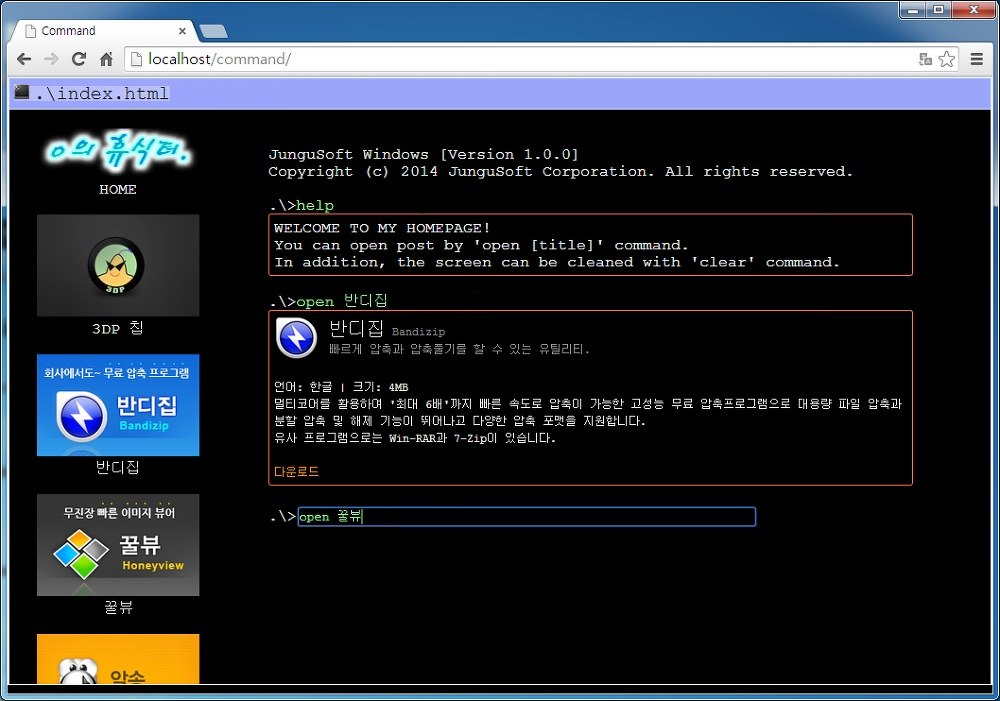

# Command Windows

Windows 명령 프롬프트처럼 꾸민 ASP 홈페이지다. 검은 화면의 입력줄에 `help`, `clear`, `open [제목]` 같은 명령을 치면 서버가 처리해 결과를 바로 아래에 이어 붙이고, `open` 은 프로그램 소개 글을 터미널 화면 안에 띄운다. 왼쪽 메뉴의 그림을 누르면 그 글을 여는 명령이 입력줄에 채워진다. 학교 과제로 만들었다.

<p>
  
</p>


## 사용 방법

ASP 를 실행할 수 있는 IIS 에 올려서 연다. Releases에서 받은 압축 파일에는 사이트 폴더 `command-windows` 와 설명, 라이선스가 들어 있다.

1. 제어판의 "Windows 기능 사용/사용 안 함" 에서 "인터넷 정보 서비스" > "World Wide Web 서비스" > "응용 프로그램 개발 기능" 아래의 ASP 를 켠다. 설치 화면은 `source/[]HowToSetupASP_1.png` 와 `source/[]HowToSetupASP_2.png` 에 있다.
2. 사이트 폴더를 `C:\inetpub\wwwroot\` 아래에 둔다.
3. 브라우저에서 `http://localhost/<폴더 이름>/` 으로 접속한다. 다른 컴퓨터에서는 `localhost` 대신 서버의 IP 주소를 쓴다.

화면은 Courier New 글꼴을 쓰고 구글 크롬에 맞춰 만들었다. 처음 열면 `help` 를 친 것처럼 안내가 떠 있다. 명령은 대소문자를 가리지 않는다.

| 명령 | 동작 |
|---|---|
| `help` | 사용법 안내를 띄운다 |
| `clear` | 화면을 지운다 |
| `open <제목>` | 글을 연다. 제목은 `3DP 칩`, `반디집`, `꿀뷰`, `알송`, `팟플레이어` |
| `<명령> & clear` | 화면을 지운 뒤 명령을 실행한다 |

그 밖의 입력에는 명령이 아니라는 메시지가 붙는다. 왼쪽 메뉴의 HOME 을 누르면 `help & clear` 가, 프로그램 그림을 누르면 `open <제목> & clear` 가 입력줄에 들어가고 Enter 를 치면 실행된다.


## 구현 원리

**화면 기록은 세션에 쌓는다.** 입력줄은 `bottom_main.asp` 자신에게 POST 하는 폼이고, ASP 는 명령을 처리한 뒤 프롬프트와 명령, 결과 상자를 HTML 로 만들어 `Session("log")` 뒤에 붙인다. 페이지는 매번 이 기록 전체를 다시 그리고 맨 아래에 새 입력줄을 놓으므로, 페이지가 새로 불려도 이전 명령과 결과가 위에 남아 터미널처럼 보인다. `clear` 는 이 세션 값을 비우고, 명령 끝의 ` & clear` 는 떼어 낸 뒤 기록을 비우고 남은 명령을 처리한다.

**글은 파일에서 읽어 끼워 넣는다.** 글마다 `bottom_<이름>.html` 이라는 HTML 조각 파일이 있고, `open` 명령이 들어오면 `ADODB.Stream` 으로 그 파일을 UTF-8 로 읽어 결과 상자 안에 그대로 넣는다.

```asp
Set stream = Server.CreateObject("ADODB.Stream")
With Stream
    .Type = 2
    .CharSet = "UTF-8"
    .Open
    .LoadFromFile(Server.MapPath(".\" & filename))
    post = .ReadText()
    .Close
End With
```

**화면은 프레임으로 나눈다.** `index.html` 의 frameset 이 위쪽 제목줄(`top_main.html`), 왼쪽 메뉴(`left_main.html`), 오른쪽 터미널(`bottom_main.asp`), 아래쪽 테두리(`bottom_draw.html`) 를 나눈다. 왼쪽 메뉴의 그림은 `target="bottom"` 인 폼이라 명령을 터미널 프레임으로 보낸다. 스크롤바는 nanoScrollerJS 로 바꿨고, 글 안의 링크에는 마우스를 올리면 색이 바뀌는 Rainbow Links 를 붙였다.


## 파일

| 경로 | 내용 |
|---|---|
| `source/index.html` | 프레임 구성 |
| `source/top_main.html` | 위쪽 제목줄 |
| `source/left_main.html` | 왼쪽 메뉴 |
| `source/bottom_main.asp` | 명령 처리와 터미널 화면 |
| `source/bottom_3dpchip.html` 등 다섯 개 | `open` 으로 여는 글 |
| `source/bottom_draw.html` | 아래쪽 테두리 |
| `source/image/` | 메뉴 그림과 아이콘 |
| `source/scrollbar_main.js` | 스크롤바 초기화 |
| `source/scrollbar_jquery.min.js`, `source/scrollbar.js`, `source/scrollbar.css`, `source/rainbow.js` | 다른 사람이 만든 스크립트 |
| `source/[]ReadMe.txt`, `source/[]HowToSetupASP_*.png` | 원래 배포물의 설명과 ASP 설치 그림 |
| `docs/screenshots/` | 스크린샷 |
| Releases | 사이트 전체 |


## 크레딧

- `scrollbar_jquery.min.js` 는 jQuery Foundation 의 jQuery 1.10.2 다. MIT 라이선스다.
- `scrollbar.js` 와 `scrollbar.css` 는 James Florentino 의 nanoScrollerJS 0.8.0 이다. MIT 라이선스다.
- `rainbow.js` 는 TAKANASHI Mizuki 의 Rainbow Links 1.03 이다.
- `image/` 의 프로그램 배너와 아이콘은 각 프로그램을 만든 회사의 것이다.


## 라이선스

zlib 라이선스다. 자세한 내용은 [LICENSE](LICENSE) 에 있다. 함께 들어 있는 것 중 다른 사람이 만든 라이브러리는 각자의 라이선스를 따른다.
